# C&C

**在浏览器里部署基地、开采矿脉、编组装甲部队，与会侦察、发展和反击的指挥智能体交战。**

从一辆基地车开始，把资源变成兵力，把侦察变成优势。抢先占领油田、切断对手供电，或者留下守军后派坦克绕到侧翼。战场运行在 Node.js 服务端，刷新浏览器就能继续当前对局。

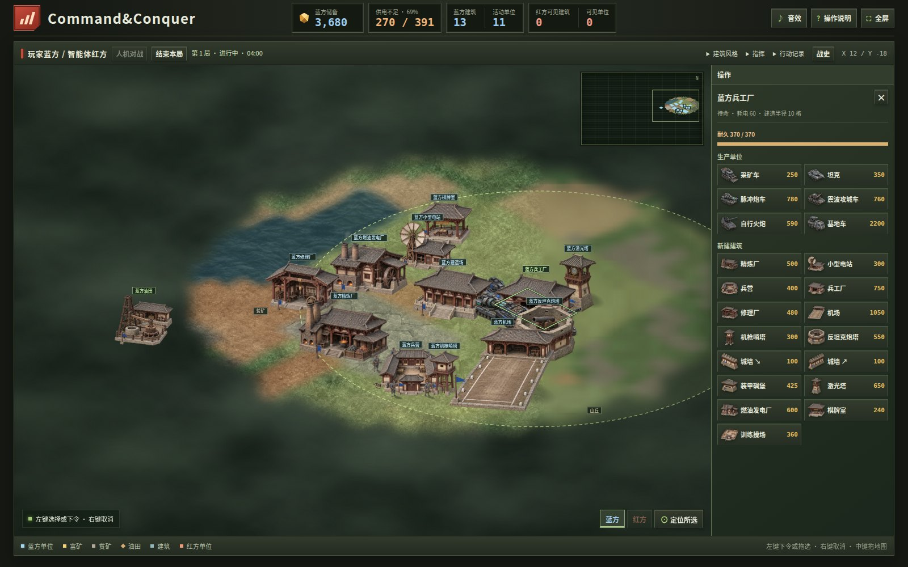

**人机对战 · 五种建筑风格 · 数字编队 · 自动探矿 · 陆空协同 · 可选 Codex 战略规划 · 战史复盘**

[快速开始](#快速开始) · [游戏玩法](#游戏玩法) · [操作指南](#操作指南) · [建筑风格](#五种建筑风格) · [智能体指挥](#智能体如何指挥) · [开发说明](#开发与架构)

> 截图使用当前游戏界面，在独立演示场景中安排建筑、兵力与资源后拍摄。战史画面展示已归档的真实对局，操练画面展示实际运行结果。不同朝代的建筑按游戏职能进行了架空改造。

## 快速开始

准备 **Node.js 22 或更新版本**，克隆仓库后即可启动。项目服务端使用 Node.js 内置模块。

```bash
git clone https://github.com/bluejoe2008/ccgame.git
cd ccgame
npm start
```

打开 [http://127.0.0.1:8770](http://127.0.0.1:8770/)，点击 **人机对战**。

1. 你指挥蓝方，红方由指挥智能体控制。
2. 将鼠标移到基地车上，点击旁边的 **部署** 图标，或选中基地车后按 **D**。双方开局各有 1 辆基地车、2 辆坦克和 3 名步兵，开局配发部队不扣资金。
3. 选中建造场，在右侧操作栏点击精炼厂、电站、兵营等建筑，再到地图上选址。
4. 精炼厂完工会配发一辆自动采矿的矿车。兵营和兵工厂建成后，点击单位图标安排生产。
5. 框选部队、按数字编队，向地图或可见敌军下令。

对局结束时显示 **你赢了** 或 **你输了**，同时保存战报。点击“查看战场”可以继续查看战况，再手动开始下一局。

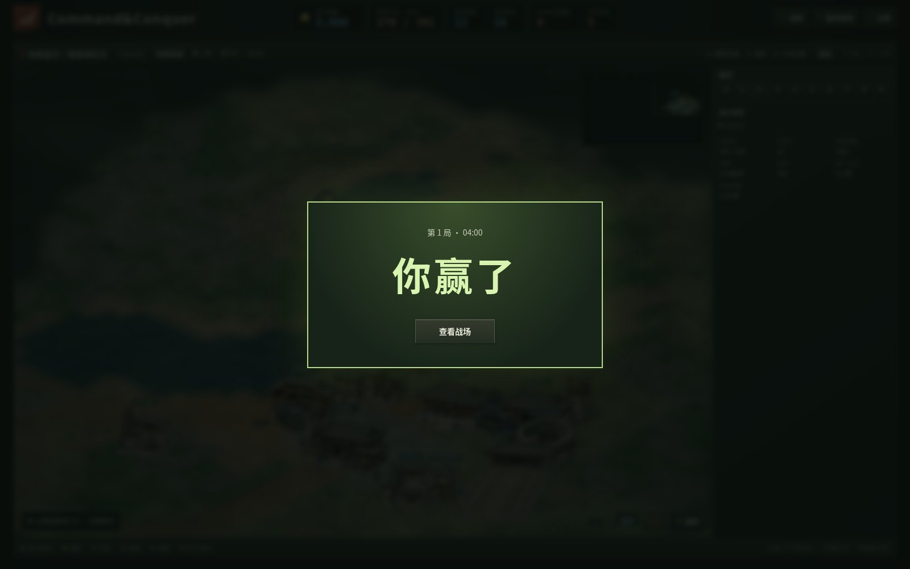

## 游戏玩法

### 从经济建立优势

矿车会寻找已探明、可到达的矿点，自动采矿、装载、返厂卸货。已知矿点耗尽或无法到达时，矿车会沿已探索的道路前往迷雾边缘，发现新矿脉后继续工作。

地图包含 **贫矿和富矿**。地表矿可以从有限的地下储量中缓慢再生，采矿范围会随着资源消耗逐渐向远处扩展。矿车拥堵时，会尝试绕路或请挡路的己方坦克让行。

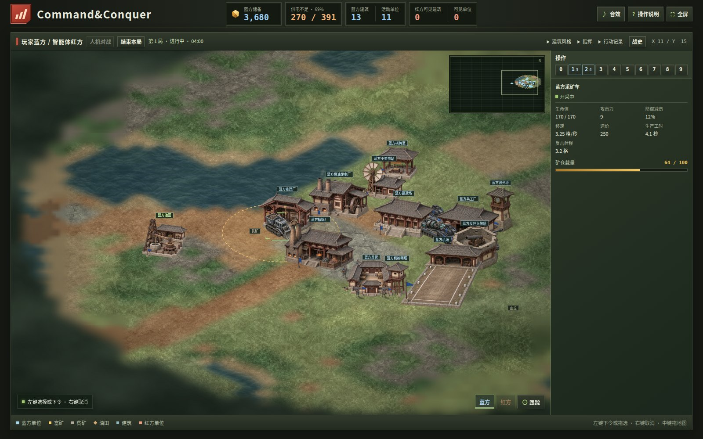

油田是另一条收入来源。派工程师占领后，首次占领奖励 **260** 储备，满供电时每 **15 秒** 收入 **280**。工程师完成占领后消失，油田可以遭受攻击、易主或被摧毁。

**已占领的油田也能成为扩张据点。** 任一己方已启用建筑提供 **10 格建造半径**，可以从基地逐步扩展，也可以在远处油田旁修建防御设施。

### 把订单交给生产队列

点击单位图标即可加入该建筑的队列。设施正在施工、已有生产任务或储备暂时不足时，都可以先安排订单。

- 按下单顺序开工，有足够储备时扣款。
- 缺钱时，队首显示“等待储备”。
- 尚未开工的订单可以取消。
- 多座兵工厂可以同时生产。满供电时，每多一座已建成兵工厂，所有兵工厂获得 **20%** 的协同生产加成，上限 **60%**。

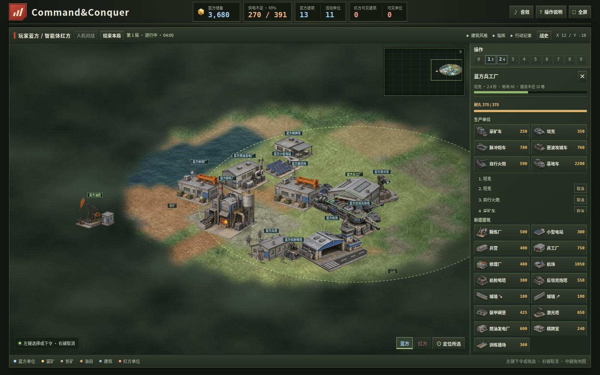

电站提供能源，生产设施和部分防御建筑需要供电。能源不足会降低生产效率，摧毁对手电站可以拖慢其补兵速度。

### 侦察、编队与交战

新一局会随机生成地图和双方出生位置。河流、桥梁、树林、山丘共同影响部队行进，地面单位具有绕障和碰撞处理。

已探索区域持续可见。你可以向**地图任意位置，包括迷雾内**下达移动命令，部队沿途揭开地图。目标位置无法进入时，地面单位会寻找最近可达处。

选中作战单位后显示动态准星，指向可见敌军时变红。点击敌方建筑或单位即可发起攻击。部队摧毁敌军后可以晋升，最高 **3 级**，每级提高 **15%** 攻击力。

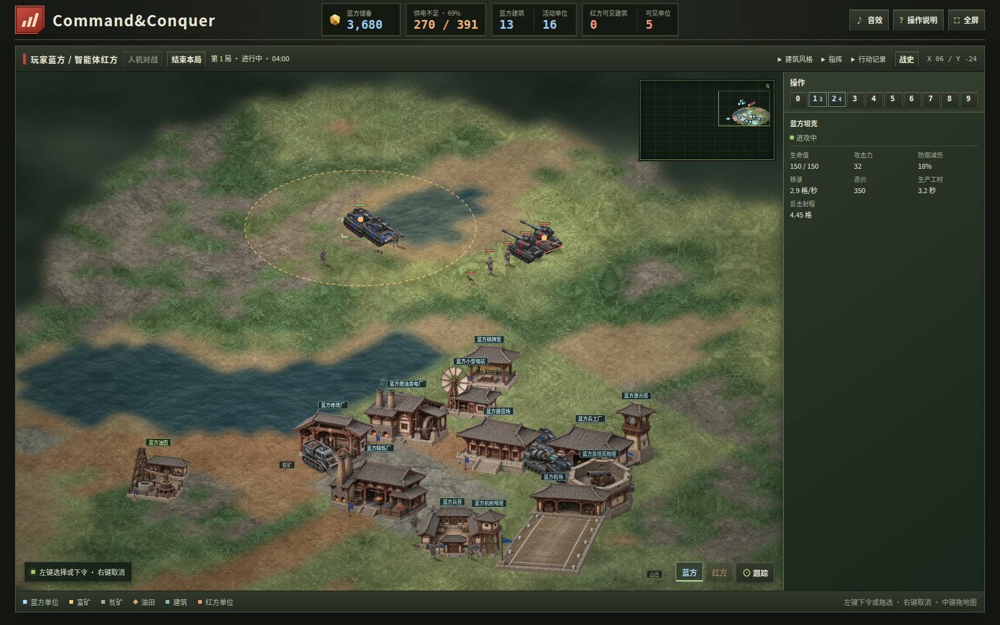

框选一组活动单位后，按 **Ctrl＋0–9** 分配编号，再直接按相应数字召回编队，也可以点击右侧已有编号。

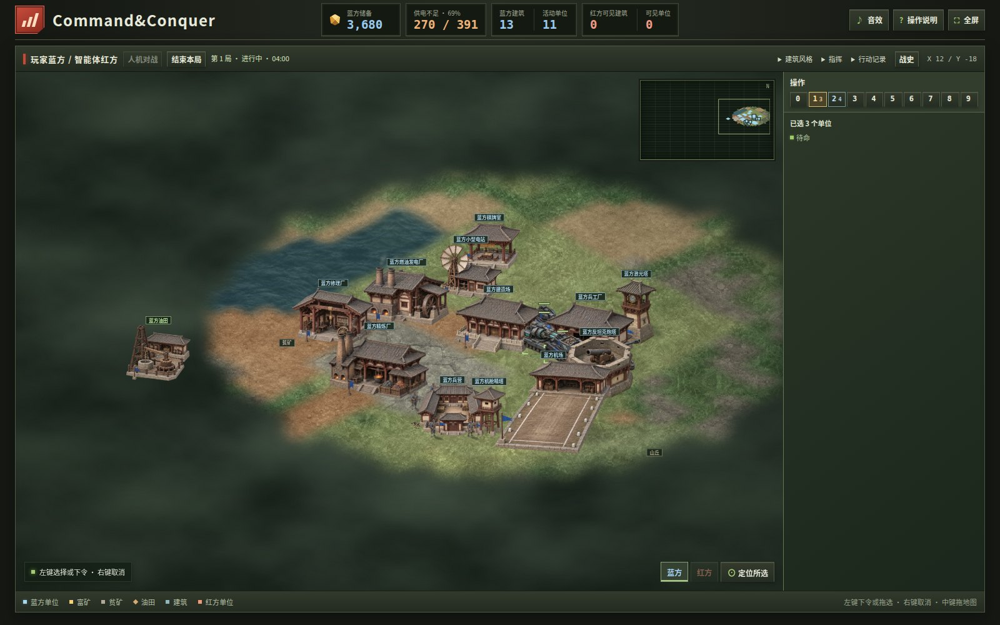

### 兵种与设施

| 单位或设施 | 在战场上的用途 |
| --- | --- |
| 基地车、建造场 | 部署基地，建立第一块建造区域；兵工厂也能生产昂贵的新基地车 |
| 矿车、精炼厂 | 自动探矿、采矿与卸货；矿车也能接受攻击指令 |
| 步兵、火箭筒兵、迫击炮兵 | 分别承担常规交火、反装甲和曲射支援 |
| 军犬 | 敏锐发现附近敌方人员，并主动追击 |
| 工程师 | 占领油田和可见敌方建筑，将所有权转为己方 |
| 战马、骑兵 | 骑兵可接近战马上马，获得骑乘状态的速度与战斗属性 |
| 坦克、自行火炮 | 装甲突击和远程火力支援 |
| 脉冲炮车、震波攻城车 | 高造价重型单位，强化反装甲或攻城火力 |
| 机枪哨塔、装甲碉堡 | 应对步兵和军犬，保护资源点与生产区 |
| 反坦克炮塔、激光塔 | 应对装甲目标，不同工事具有不同射程和防护属性 |
| 城墙 | 阻挡地面通行，保护重要设施 |
| 修理厂 | 自动接收受损坦克，消耗储备逐步修复，再将其放行 |
| 小型电站、燃油发电厂 | 维持基地能源供给 |
| 棋牌室、训练操场 | 为己方活动单位提供射速或伤害加成 |

机场可以生产三类飞机。

| 飞机 | 行动方式 |
| --- | --- |
| 轰炸机 | 对指定敌军或地图坐标投弹一次，随后返航 |
| 侦察机 | 探索地图，提供更广的侦察视野 |
| 运输直升机 | 最多搭载四名己方人员或军犬，飞抵目的地后卸载 |

固定翼飞机失去可用跑道后会尝试寻找替代机场，最终可能迫降坠毁。飞机、装甲、步兵和防御工事的搭配，会影响资源投入和进攻节奏。

**胜负条件**为一方失去全部建筑和活动单位。双方同时失去全部单位时为平局。

## 五种建筑风格

每一方都可以独立选择建筑风格，也可以选择“每局随机”。固定选项立即生效，并保存到下一局，红蓝双方通过旗帜或涂装区分。

### 原版写实

工业设施、装甲工事和机场组成现代基地。

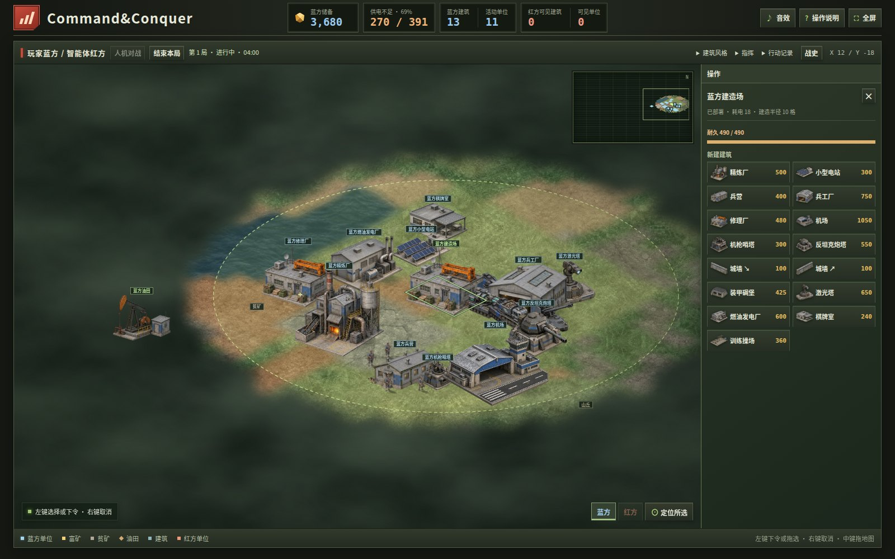

### 红军年代

土墙、旧瓦、木梁和山村工坊构成更朴素的基地外观。

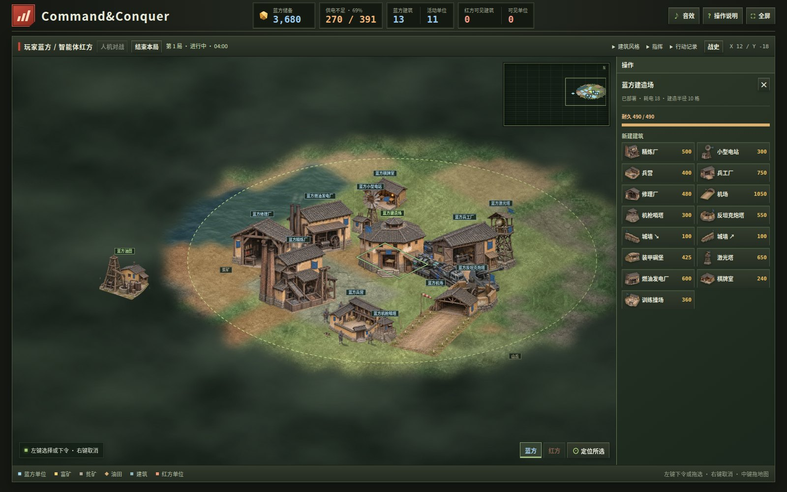

### 秦汉古风

以夯土台基、低缓瓦顶、木构建筑和汉阙轮廓表现早期帝国风格。

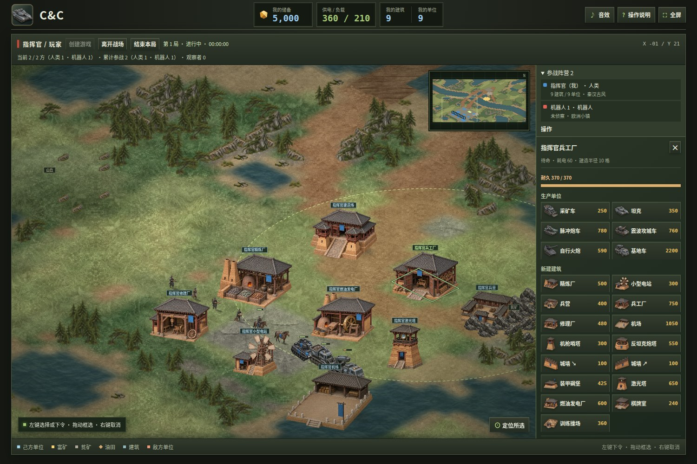

### 唐代建筑

深远出檐、粗壮斗拱和宽阔灰瓦屋顶，围绕工坊与院落展开。


### 清代建筑

朱红柱、琉璃瓦和彩绘梁枋，为基地带来鲜明的宫苑色彩。

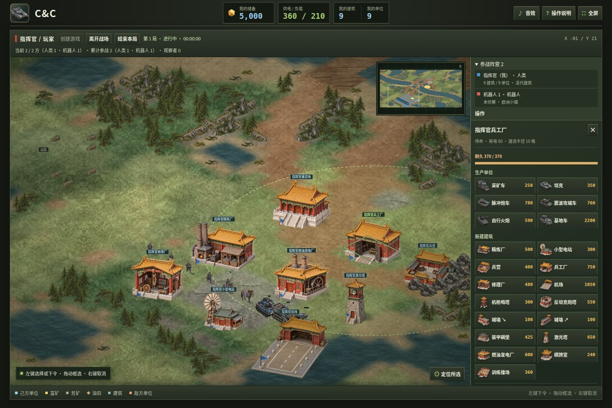

建筑具有施工骨架、逐步填充、受损外观和运转细节。地面可留下炮击痕迹，坦克炮塔、人员与军犬带有待命和行进动作，音效根据与当前视图的距离衰减并混合播放。

## 操作指南

建造、生产、单位属性、订单和编队统一放在**地图右侧的固定操作栏**。

| 操作 | 效果 |
| --- | --- |
| 左键点击己方单位 | 选择单位 |
| 左键拖动 | 框选多个己方活动单位 |
| 选中部队后左键点击地图 | 指定移动目的地 |
| 选中作战单位后点击可见敌军 | 下达攻击指令 |
| 选中工程师后点击可见油田或敌方建筑 | 尝试占领 |
| 右键 | 取消当前选择或建筑放置 |
| 选中活动单位后按 Ctrl＋0–9 | 保存为对应编号编队 |
| 直接按 0–9 | 召回对应编队 |
| 点击右侧已有编队编号 | 召回该编队 |
| 中键拖动、方向键 | 移动地图视图 |
| 滚轮、Shift＋滚轮 | 分别上下、左右移动地图；触控板支持横向滚动 |
| 未选中部队时，在空白地图上左键拖动 | 拖动地图视图 |
| 鼠标靠近地图边缘 | 显示方向箭头并自动滚屏，越靠近边缘越快；在四角可斜向滚动 |
| 点击或拖动小地图 | 切换当前视图区域 |
| F | 定位或跟踪所选单位；多人编队定位到队伍中心 |
| H | 返回己方基地；尚未部署时定位到基地车 |
| D | 将选中的己方基地车部署为建造场 |
| 选中兵工厂或兵营后点击空地 | 设置生产单位集结点 |
| 点击单位图标 | 加入生产队列 |
| 点击建筑图标，再点击地图空地 | 建造建筑 |
| 选中己方建筑，点击“出售” | 按剩余耐久回收一半造价，另退已付款生产的未完成部分 |
| 点击建筑风格 | 分别设置红蓝方风格 |
| 点击战史 | 查看归档对局、复盘与行动日志 |

当前浏览器页签刷新时，会保留本局编队。人机局进行中使用蓝方视角，结束后可以切换红蓝方视角查看战场与记录。

## 智能体如何指挥

红方的本地指挥逻辑持续评估侦察、资金、生产、能源、兵力和已知威胁，再执行发展、进攻、回援或防御任务。资源点争夺、留守兵力和对手经济设施，都参与决策。

可以通过 **Codex CLI** 为它增加大模型战略规划。先在运行服务的用户环境中完成 CLI 安装和登录，并保证 `codex` 位于 `PATH`，随后启动。

```bash
npm start -- --codex
```

启用后，系统将当前阵营的已知战况和可执行候选目标交给大模型。模型选择主计划及可选的后续计划，本地指挥逻辑结合即时战况决定是否采用，并执行寻路、建造、生产和战斗。调用失败时继续执行本地计划。

当前规划任务覆盖经济、供电、扩建兵工厂、空军、侦察、推进、油田、袭扰、拦截和防御。行动日志中的 **“采用 Codex 计划”** 可以用于确认实际采用情况。

### 战史与经验

每局结束后保存双方行动日志与复盘，内容包括胜负、剩余兵力、建筑损失、计划完成情况和油田收支。

下一局会读取各阵营最近 **8 场分出胜负的对局**，提取发展与作战重点，并调整候选计划权重。油田行动也会记录工程师成本、占领耗时、持有时长及已确认的近场护卫损失，用于调整后续争夺偏好。

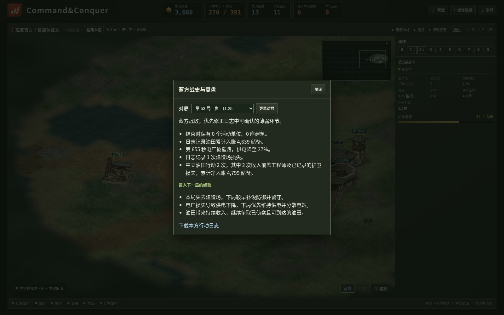

经验通过日志、复盘统计与决策权重持久化。模型输出是战略选项选择，复盘记录的是游戏执行结果。

### 场景操练

打开“指挥 → 场景操练”，让红蓝双方在独立场景中执行四类任务。

| 操练 | 观察内容 |
| --- | --- |
| 改线侦察 | 侦察回报用时、前线兵力与基地留守 |
| 小队试探 | 出动规模、目标完成用时与留守兵力 |
| 受袭回援 | 回援人数及防守指令 |
| 争夺油田 | 占领用时、持有时长与投入收入 |

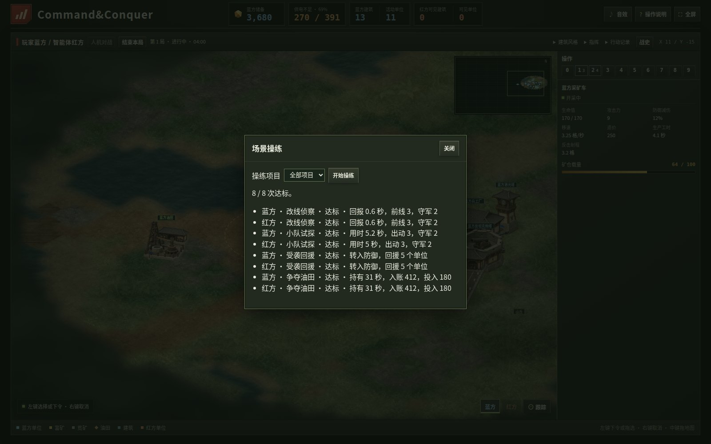

也可以从命令行运行。

```bash
# 四种场景，红蓝方分别执行
node training.cjs --drills

# 仅运行争夺油田
node training.cjs --drills oil

# 使用固定地图种子执行整局对照
node training.cjs 2296959562
```

整局对照包含双基线和交换实验方出生点的对局，使用固定地图和随机序列。操练运行在独立进程中。

## 服务器运行与存档

### 局域网访问

```bash
npm start -- --bind 0.0.0.0 --port 8770
```

其他设备打开 `http://服务器IP:8770/`。同一服务地址上的浏览器共享一个战场和蓝方操作，当前会话的状态保存在服务端。

### 指定存档

```bash
npm start -- --state /path/to/match.bin
```

默认存档为 `$XDG_STATE_HOME/ore-command/match.bin`，未设置该环境变量时使用 `~/.local/state/ore-command/match.bin`。战史保存到存档文件路径加 `.history` 的目录。

运行中的对局定期保存，服务重启后恢复存档。浏览器刷新会重新接入当前进度。每次手动开新局会重新生成地图，人机局分出胜负后等待玩家开启下一局。

## 开发与架构

前端使用原生 JavaScript 与 Canvas 2D，将位图素材、地图纹理、迷雾、阴影和战斗效果组合成战场。地形使用工作线程，服务端由 Node.js 工作线程推进模拟，浏览器轮询战况并插值显示单位运动。

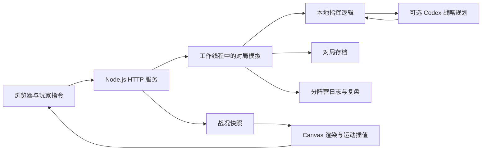

| 文件 | 职责 |
| --- | --- |
| `server.cjs` | 网页、HTTP 接口、指令转发与规划服务 |
| `match-worker.cjs` | 服务端对局模拟、快照、存档与开局 |
| `game.js` | 游戏规则、单位与建筑、寻路、战斗及渲染 |
| `commander.js` | 候选战略、计划评估与本地指挥 |
| `game-planner.cjs` | 调用 Codex CLI，验证战略输入输出 |
| `observer.js` | 战况同步、玩家指令、历史和结果对话框 |
| `terrain-worker.js` | 地形绘制 |
| `battle-history.cjs` | 行动日志、战报与经验提取 |
| `training.cjs` | 场景操练与固定地图对照 |
| `building-themes.js` | 建筑风格、素材映射与运转效果参数 |

主要接口如下。需要修改战局的请求通过 `X-Match-Id` 关联当前对局。

| 接口 | 用途 |
| --- | --- |
| `GET /api/match/status` | 对局编号、模式、进度与胜负 |
| `GET /api/match?perspective=player` | 蓝方可见战况 |
| `GET /api/match?perspective=enemy` | 对应视角战况，人机局进行中返回蓝方视角 |
| `POST /api/match/start-human` | 开始人机对战 |
| `POST /api/match/end` | 结束当前对局 |
| `POST /api/match/order` | 下达建造、生产、移动、攻击等指令 |
| `POST /api/match/building-style` | 设置建筑风格 |
| `GET /api/history?perspective=player` | 当前阵营的归档复盘，支持 `before` 分页 |
| `GET /api/history/<局号>/log?perspective=player` | 下载当前阵营行动日志 |
| `POST /api/training/drills` | 执行独立场景操练 |

位图素材和生成提示词可在 [assets](assets/) 与 [素材生成记录](assets/PROMPTS.md) 中查看，README 实机截图位于 [docs/screenshots](docs/screenshots/)。

如果你喜欢这个浏览器 RTS，欢迎点一个 **Star**，分享你的基地布局、对战录像或战报。也欢迎通过 [Issues](https://github.com/bluejoe2008/ccgame/issues) 提交带有复现步骤的操作、画面和智能体问题，或通过 Pull Request 改进游戏。
