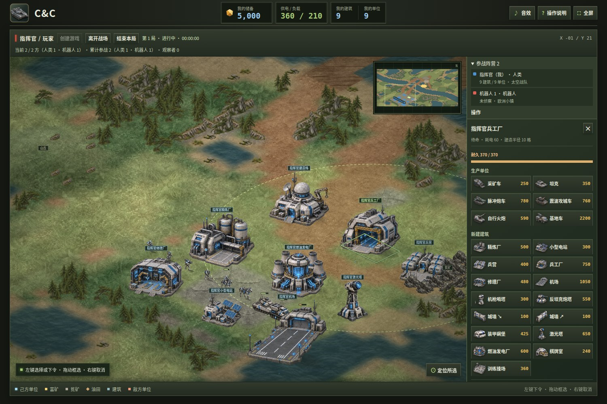
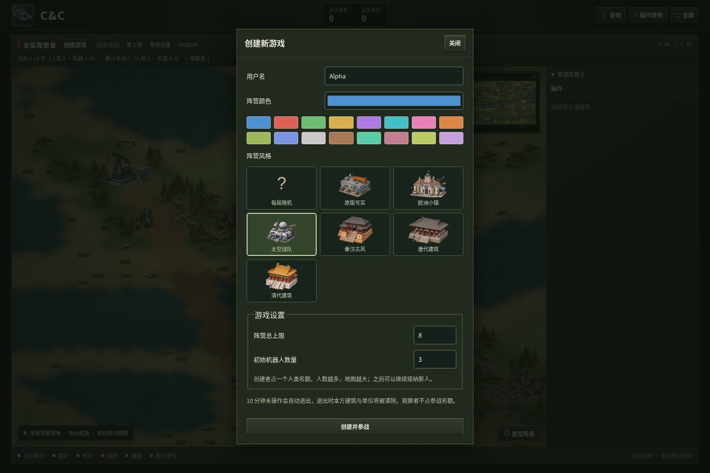
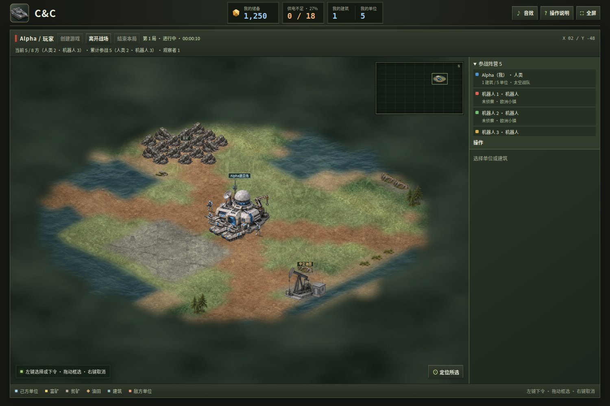
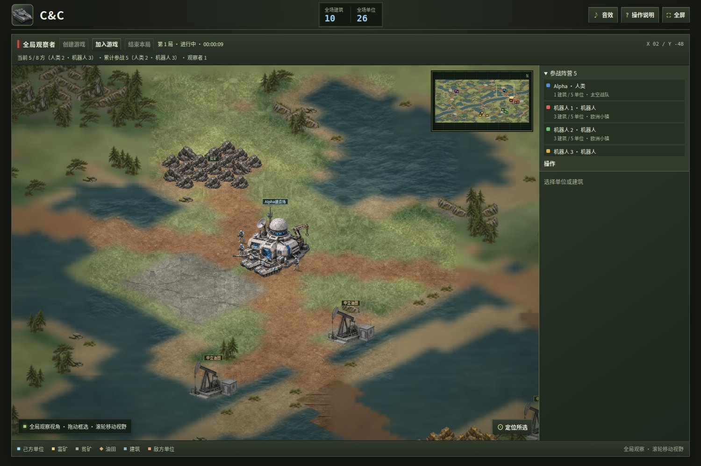
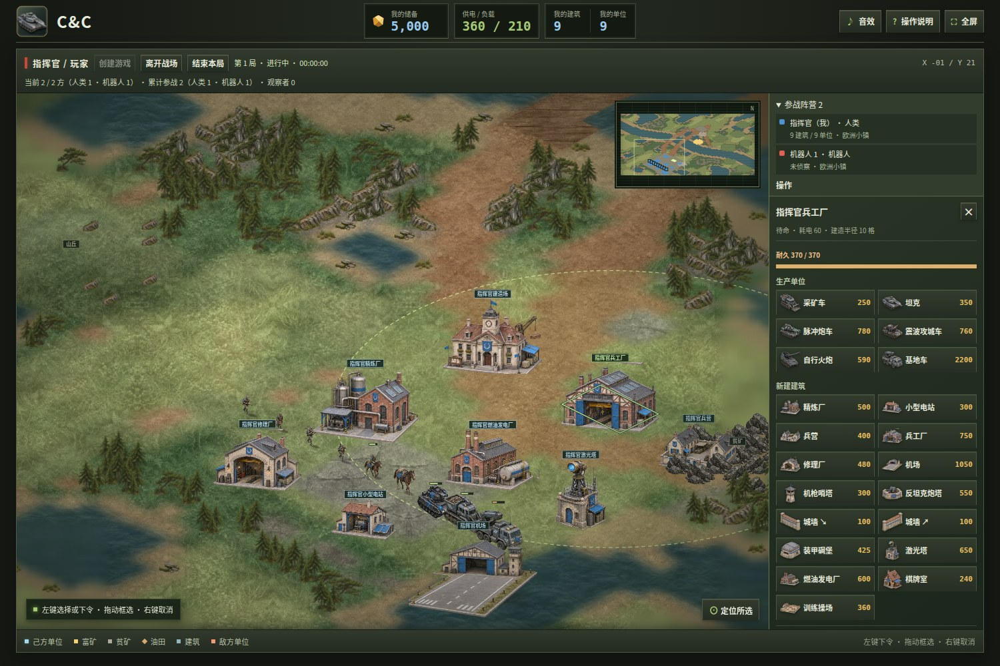
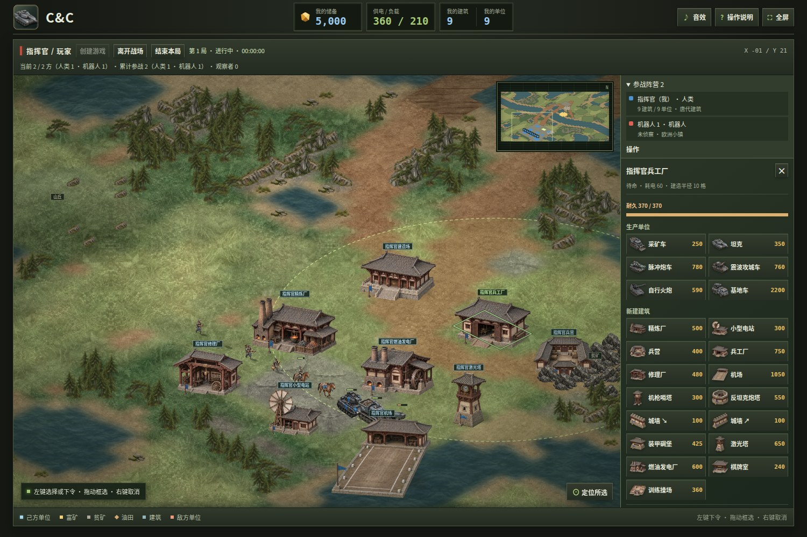
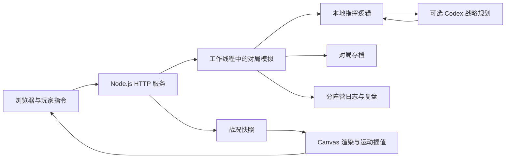

# C&C

**在浏览器里部署基地、开采矿脉、编组装甲部队，与其他玩家及会侦察、发展和反击的指挥智能体交战。**

从一辆基地车开始，把资源变成兵力，把侦察变成优势。抢先占领油田、切断对手供电，或者留下守军后派坦克绕到侧翼。战场运行在 Node.js 服务端，刷新浏览器就能继续当前对局。



**多人混战 · 全局观战 · 六种阵营风格 · 数字编队 · 自动探矿 · 陆空协同 · 可选 Codex 战略规划**

[快速开始](#快速开始) · [游戏玩法](#游戏玩法) · [操作指南](#操作指南) · [阵营风格](#六种阵营风格) · [智能体指挥](#智能体如何指挥) · [开发说明](#开发与架构)


> 风格截图使用当前渲染器，在独立演示场景中布置建筑和部队后拍摄；创建、参战及全局观察截图来自三个独立浏览器的联机验证。朝代外观属于架空改造，风格不改变战斗数值。

## 快速开始

准备 **Node.js 22 或更新版本**。服务端使用 Node.js 内置模块，无需安装运行时依赖。

```bash
git clone https://github.com/bluejoe2008/ccgame.git
cd ccgame
npm start
```

打开 [http://127.0.0.1:8770](http://127.0.0.1:8770/)。新浏览器默认以全局观察者身份进入。

1. 点击 **创建游戏**，输入用户名、阵营颜色和风格，设置总上限 **2～16 方**及初始机器人数量。创建者占一个人类席位。
2. 其他浏览器点击 **加入游戏**，选择未被当前参战方使用的用户名和颜色，也可以一直观战。
3. 每方开局获得 **1 辆基地车、2 辆坦克、3 名步兵和 1,250 储备**。选中基地车按 **D**，或鼠标移到车旁点击部署图标。
4. 选中己方已启用的建筑，在右侧图标操作栏安排建造和生产。先建立电力与采矿收入，再扩张与交战。
5. 左键框选部队、左键下令，**Ctrl＋数字**保存编队。已探索地图持续可见，迷雾内也可以指定移动目的地。



## 多人游戏规则

同一服务始终只有一场正在运行的游戏，玩家与机器人各自拥有阵营，任意两方均可交战。创建时人数上限越高，地图越大；一局进行中保持地图不变。

| 身份 | 视野与指挥 | 创建、加入与结束 |
| --- | --- | --- |
| 参战玩家 | 只控制自己的部队；接收本方已探明战况，不获得其他阵营的隐藏统计 | 占一个席位；可主动离开；仅剩自己一个人类参战时可结束本局 |
| 机器人 | 按本方侦察、资源和已知威胁独立发展与作战 | 占一个席位；由创建时的数量设置加入 |
| 全局观察者 | 可查看整个战场及各方数量，无法下令 | 不占参战席位；没有人类玩家参战时可结束本局 |

- **允许持续补位**：被淘汰、主动离开或因闲置移出的玩家释放名额，新人可在游戏进行中加入；出生区被其他部队占用时须等待安全位置。
- **离开即清场**：退出者的建筑、油田、活动单位和运输机载员会以爆炸效果消失，不交给机器人接管。
- **10 分钟未操作自动移出**：最后 1 分钟显示提醒。实际鼠标、键盘、触摸及滚轮操作会恢复计时，后台轮询不会续期。
- **刷新保留身份与进度**：同一浏览器依靠会话 Cookie 重连，不重复计入累计参战人数。主动离开后再次加入是一名新参战者。不同浏览器或无痕会话使用独立身份。
- **最后存活的一方获胜**：一方失去全部建筑与活动单位即淘汰；至少两方参战后才开始判定最终胜者。人类参战者会看到醒目的“你赢了”或“你输了”。
- **结束后等待人类创建**：自然分出胜负或手动结束后，都不自动开下一局。手动结束不判胜负；新一局重新随机生成地图。

页面显示当前局号、持续时间、参战人数/上限、人类与机器人数量、观察者人数及累计参战数量。累计数包含已离开和已淘汰者，观察者不计入参战数量。





## 游戏玩法

### 从经济建立优势

矿车会寻找已探明、可到达的矿点，自动采矿、装载、返厂卸货。已知矿点耗尽或无法到达时，矿车会沿已探索的道路前往迷雾边缘，发现新矿脉后继续工作。

地图包含 **贫矿和富矿**。地表矿可以从有限的地下储量中缓慢再生，采矿范围会随着资源消耗逐渐向远处扩展。矿车拥堵时，会尝试绕路或请挡路的己方坦克让行。


油田是另一条收入来源。派工程师占领后，首次占领奖励 **260** 储备，满供电时每 **15 秒** 收入 **280**。工程师完成占领后消失，油田可以遭受攻击、易主或被摧毁。

**已占领的油田也能成为扩张据点。** 任一己方已启用建筑提供 **10 格建造半径**，可以从基地逐步扩展，也可以在远处油田旁修建防御设施。

### 把订单交给生产队列

点击单位图标即可加入该建筑的队列。设施正在施工、已有生产任务或储备暂时不足时，都可以先安排订单。

- 按下单顺序开工，有足够储备时扣款。
- 缺钱时，队首显示“等待储备”。
- 尚未开工的订单可以取消。
- 多座兵工厂可以同时生产。满供电时，每多一座已建成兵工厂，所有兵工厂获得 **20%** 的协同生产加成，上限 **60%**。


电站提供能源，生产设施和部分防御建筑需要供电。能源不足会降低生产效率，摧毁对手电站可以拖慢其补兵速度。

### 侦察、编队与交战

新一局会随机生成地图和各方出生位置。河流、桥梁、树林、山丘共同影响部队行进，地面单位具有绕障和碰撞处理。

已探索区域持续可见。你可以向**地图任意位置，包括迷雾内**下达移动命令，部队沿途揭开地图。目标位置无法进入时，地面单位会寻找最近可达处。

选中作战单位后显示动态准星，指向可见敌军时变红。点击敌方建筑或单位即可发起攻击。部队摧毁敌军后可以晋升，最高 **3 级**，每级提高 **15%** 攻击力。


框选一组活动单位后，按 **Ctrl＋0–9** 分配编号，再直接按相应数字召回编队，也可以点击右侧已有编号。


### 兵种与设施

| 单位或设施 | 在战场上的用途 |
| --- | --- |
| 基地车、建造场 | 部署基地，建立第一块建造区域；兵工厂也能生产昂贵的新基地车 |
| 矿车、精炼厂 | 自动探矿、采矿与卸货；矿车也能接受攻击指令 |
| 步兵、火箭筒兵、迫击炮兵 | 分别承担常规交火、反装甲和曲射支援 |
| 军犬 | 敏锐发现附近敌方人员，并主动追击 |
| 工程师 | 占领油田和可见敌方建筑，将所有权转为己方 |
| 战马、骑兵 | 骑兵可接近战马上马，获得骑乘状态的速度与战斗属性 |
| 坦克、自行火炮 | 装甲突击和远程火力支援 |
| 脉冲炮车、震波攻城车 | 高造价重型单位，强化反装甲或攻城火力 |
| 机枪哨塔、装甲碉堡 | 应对步兵和军犬，保护资源点与生产区 |
| 反坦克炮塔、激光塔 | 应对装甲目标，不同工事具有不同射程和防护属性 |
| 城墙 | 阻挡地面通行，保护重要设施 |
| 修理厂 | 自动接收受损坦克，消耗储备逐步修复，再将其放行 |
| 小型电站、燃油发电厂 | 维持基地能源供给 |
| 棋牌室、训练操场 | 为己方活动单位提供射速或伤害加成 |

机场可以生产三类飞机。

| 飞机 | 行动方式 |
| --- | --- |
| 轰炸机 | 对指定敌军或地图坐标投弹一次，随后返航 |
| 侦察机 | 探索地图，提供更广的侦察视野 |
| 运输直升机 | 最多搭载四名己方人员或军犬，飞抵目的地后卸载 |

固定翼飞机失去可用跑道后会尝试寻找替代机场，最终可能迫降坠毁。飞机、装甲、步兵和防御工事的搭配，会影响资源投入和进攻节奏。

**淘汰条件**为一方失去全部建筑和活动单位。只剩一方时该方获胜；所有阵营同时失去全部单位时为平局。

## 六种阵营风格

创建或加入时，通过配图卡片选择风格。每个阵营独立选择，并通过自选颜色区分敌我；“每局随机”会为本次参战抽取一种风格。已移除“红军年代”选项，原版步兵使用现代战术形象。

| 风格 | 建筑与配套单位 |
| --- | --- |
| 原版写实 | 现代工业基地、装甲工事与现代步兵 |
| 欧洲小镇 | 石墙、坡屋顶、钟楼与工坊；配套步兵、工兵、骑兵和战马 |
| 太空战队 | 太空基地、能量设施、科幻工事；动力装甲兵、工程师、反装甲兵、能量迫击兵、机械骑兵与机械战马，配套基地车、矿车、坦克和火炮 |
| 秦汉古风 | 夯土台基、瓦顶和汉阙；秦兵、工匠、重弩手、投石兵、骑兵与战马 |
| 唐代建筑 | 深远出檐、斗拱与院落；唐军步兵、工匠、支援兵种、骑兵与战马 |
| 清代建筑 | 琉璃瓦、朱红柱与彩绘梁枋；清军步兵、工匠、火器支援兵、骑兵与战马 |

历史风格的坦克等车辆，以及军犬和飞机，继续使用现有模型和阵营涂装。各套步兵、工匠与骑兵提供四个朝向；太空坦克使用独立车体和炮塔，支持转向瞄准。

### 欧洲小镇



### 太空战队


### 秦汉、唐代与清代





### 原版写实


建筑具有施工骨架、逐步填充、受损外观和运转细节。地面留下炮击痕迹，坦克炮塔、人员与军犬具有待命和行进动作，音效随距离衰减并混合播放。

## 操作指南

建造、生产、单位属性、订单和编队统一放在**地图右侧的固定操作栏**。

| 操作 | 效果 |
| --- | --- |
| 左键点击己方单位 | 选择单位 |
| 左键拖动 | 框选多个己方活动单位 |
| 选中部队后左键点击地图 | 指定移动目的地 |
| 选中作战单位后点击可见敌军 | 下达攻击指令 |
| 选中工程师后点击可见油田或敌方建筑 | 尝试占领 |
| 右键 | 取消当前选择或建筑放置 |
| 选中活动单位后按 Ctrl＋0–9 | 保存为对应编号编队 |
| 直接按 0–9 | 召回对应编队 |
| 点击右侧已有编队编号 | 召回该编队 |
| 方向键 | 移动地图视图 |
| 滚轮、Shift＋滚轮 | 分别上下、左右移动地图；触控板支持横向滚动 |
| 鼠标靠近地图边缘 | 显示方向箭头并自动滚屏，越靠近边缘越快；在四角可斜向滚动 |
| 点击或拖动小地图 | 切换当前视图区域 |
| F | 定位或跟踪所选单位；多人编队定位到队伍中心 |
| H | 返回己方基地；尚未部署时定位到基地车 |
| D | 将选中的己方基地车部署为建造场 |
| 选中兵工厂或兵营后点击空地 | 设置生产单位集结点 |
| 点击单位图标 | 加入生产队列 |
| 点击建筑图标，再点击地图空地 | 建造建筑 |
| 选中己方建筑，点击“出售” | 按剩余耐久回收一半造价，另退已付款生产的未完成部分 |

当前浏览器页签刷新时，会保留本局编队。点击顶部人数信息旁的“参战阵营”可弹出列表，不挤动地图或右侧菜单；点击外部、关闭按钮或按 Esc 可收起。观察者可点击阵营定位各方，玩家只能定位自己已经发现的对象，定位后菜单自动关闭。右侧空间用于建造、生产与单位操作。右上方已移除建筑风格、指挥、行动记录及战史菜单。

## 智能体如何指挥

每个机器人的本地指挥逻辑持续评估侦察、资金、生产、能源、兵力和已知威胁，再执行发展、进攻、回援或防御任务。资源点争夺、留守兵力和对手经济设施，都参与决策。

可以通过 **Codex CLI** 为它增加大模型战略规划。先在运行服务的用户环境中完成 CLI 安装和登录，并保证 `codex` 位于 `PATH`，随后启动。

```bash
npm start -- --codex
```

启用后，系统将当前阵营的已知战况和可执行候选目标交给大模型。模型选择主计划及可选的后续计划，本地指挥逻辑结合即时战况决定是否采用，并执行寻路、建造、生产和战斗。调用失败时继续执行本地计划。

当前规划任务覆盖经济、供电、扩建兵工厂、空军、侦察、推进、油田、袭扰、拦截和防御。服务器归档的行动日志中，**“采用 Codex 计划”** 表明实际采用了模型建议；未加启动参数时仅使用本地指挥逻辑。

### 战史与经验

每局结束后保存各参战阵营的行动日志与复盘，内容包括胜负、剩余兵力、建筑损失、计划完成情况和油田收支。

新局会读取最近 **8 场分出胜负的对局**，从对应角色的复盘中提取发展与作战重点，供机器人调整候选计划权重。油田行动也会记录工程师成本、占领耗时、持有时长及已确认的近场护卫损失，用于调整后续争夺偏好。

经验通过日志、复盘统计与决策权重持久化。模型输出是战略选项选择，复盘记录的是游戏执行结果。

### 场景操练

可通过命令行，让两个基线阵营在独立场景中执行四类任务。

| 操练 | 观察内容 |
| --- | --- |
| 改线侦察 | 侦察回报用时、前线兵力与基地留守 |
| 小队试探 | 出动规模、目标完成用时与留守兵力 |
| 受袭回援 | 回援人数及防守指令 |
| 争夺油田 | 占领用时、持有时长与投入收入 |

运行以下命令：

```bash
# 四种场景，红蓝方分别执行
node training.cjs --drills

# 仅运行争夺油田
node training.cjs --drills oil

# 使用固定地图种子执行整局对照
node training.cjs 2296959562
```

整局对照包含双基线和交换实验方出生点的对局，使用固定地图和随机序列。操练运行在独立进程中。

## 服务器运行与存档

### 局域网访问

```bash
npm start -- --bind 0.0.0.0 --port 8770
```

其他设备打开 `http://服务器IP:8770/`。同一服务地址上的浏览器连接同一战场，各自以会话身份参战或全局观战。浏览器只提交自己的操作，权威状态保存在服务端。

### 指定存档

```bash
npm start -- --state /path/to/match.bin
```

默认存档为 `$XDG_STATE_HOME/ore-command/match.bin`，未设置该环境变量时使用 `~/.local/state/ore-command/match.bin`。战史保存到存档文件路径加 `.history` 的目录。

运行中的对局定期保存，服务重启后恢复存档。浏览器刷新会重新接入当前进度。每次手动创建新游戏会重新生成地图，多人局结束后等待人类创建下一局。会话身份与累计参战记录随存档保存。旧版两方存档会保留地图和单位迁移：原蓝方可由首位加入者接管。

## 开发与架构

前端使用原生 JavaScript 与 Canvas 2D，将位图素材、地图纹理、迷雾、阴影和战斗效果组合成战场。地形使用工作线程，服务端由 Node.js 工作线程推进模拟，浏览器轮询战况并插值显示单位运动。



| 文件 | 职责 |
| --- | --- |
| `server.cjs` | 网页、HTTP 接口、指令转发与规划服务 |
| `match-worker.cjs` | 多人席位、闲置移出、权限、对局模拟、快照与存档 |
| `game.js` | 游戏规则、单位与建筑、寻路、战斗及渲染 |
| `commander.js` | 候选战略、计划评估与本地指挥 |
| `game-planner.cjs` | 调用 Codex CLI，验证战略输入输出 |
| `observer.js` | 会话身份、房间控制、战况同步、玩家指令与结果对话框 |
| `terrain-worker.js` | 地形绘制 |
| `battle-history.cjs` | 行动日志、战报与经验提取 |
| `training.cjs` | 场景操练与固定地图对照 |
| `building-themes.js` | 建筑风格、素材映射与运转效果参数 |

主要接口如下。服务端通过 HttpOnly 会话 Cookie 识别身份。修改战局的请求必须携带当前对局的 `X-Match-Id`；伪造视角或其他阵营的单位 ID 不会获得控制权。

| 接口 | 用途 |
| --- | --- |
| `GET /api/match/status` | 对局信息、自己身份、权限、阵营列表与累计人数 |
| `GET /api/match` | 当前身份可见快照，观察者收到全局快照 |
| `POST /api/match/create` | `{name,color,theme,capacity,bots}` 创建并参战 |
| `POST /api/match/join` | `{name,color,theme}` 申请加入当前游戏 |
| `POST /api/match/leave` | 主动离开并清除所属资产 |
| `POST /api/match/end` | 按人类人数规则手动结束，不判胜负 |
| `POST /api/session/activity` | 报告实际交互，恢复闲置计时 |
| `POST /api/match/order` | 对自己阵营下达建造、生产、移动、攻击等指令 |
| `GET /api/history?perspective=<阵营ID>` | 归档复盘，支持 `before` 分页 |
| `GET /api/history/<局号>/log?perspective=<阵营ID>` | 下载阵营行动日志 |
| `POST /api/training/drills` | 运行独立场景操练 |

历史接口查询已经归档的战报与阵营日志。历史与场景操练保留服务端接口及命令行入口。

```bash
npm test
node training.cjs --drills
```

自动检查覆盖多方互相交战、指令归属、补位、退出爆炸、会话恢复、闲置移出、观察者权限、最后存活判胜及六套素材完整性。测试使用独立存档，不影响正常运行的战场。

位图素材和生成提示词可在 [assets](assets/) 与 [素材生成记录](assets/PROMPTS.md) 中查看，README 实机截图位于 [docs/screenshots](docs/screenshots/)。

如果你喜欢这个浏览器 RTS，欢迎点一个 **Star**，分享你的基地布局、对战录像或战报。也欢迎通过 [Issues](https://github.com/bluejoe2008/ccgame/issues) 提交带有复现步骤的操作、画面和智能体问题，或通过 Pull Request 改进游戏。
